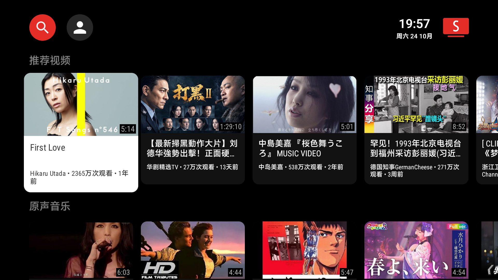

# 小米电视改造全记录（MiTV-ASTR0）

> 目标：去掉开机广告桌面、装上 YouTube / 影视聚合 / 浏览器，让一台普通小米电视变成能用的电视盒子。
> 全程**免 root**、**不卸载系统应用**、**可一键回滚**。

---

## 一、改造后是什么样

| 项目 | 结果 |
|---|---|
| 开机桌面 | 小米广告桌面 → **CleanYourTV 定制版**（带天气动效、App 最近使用排序） |
| YouTube | SmartTube（电视版，无广告，支持 4K/登录） |
| 影视聚合 | FongMi（多仓聚合播放器，需自备接口源） |
| 浏览器 | TVBro → 打开直接进**抖音网页版** |
| 系统精简 | 停用 8 个小米自家服务（**没动任何第三方 App**） |
| 网络 | 电视走电脑 clash 代理，实现看 YouTube |

<p align="center">
  <br>
  <sub>改造后的桌面：干净的 App 网格 + 天气信息，没有广告位</sub>
</p>

<p align="center">
  <br>
  <sub>SmartTube 正常加载推荐（走电脑代理出去）</sub>
</p>


---

## 二、前提条件

1. 电视和电脑在**同一局域网**（同一路由器，同一网段）
2. 电视开启 ADB 调试
   - 路径：`设置 → 账号与安全 → ADB 调试`
   - 找不到的话：`设置 → 关于 → 产品型号` 连点 5~7 次，再回设置里找
3. 电脑装 `platform-tools`（Android SDK 的小工具包）
4. 拿到电视 IP：路由器后台设备列表，或 `设置 → 网络 → 当前网络` 里看

> 📌 **网段会变**。电视重连 WiFi 后 IP 可能变，连不上先重新确认 IP。

---

## 三、连接电视

```bash
adb connect <电视IP>:5555
adb devices
```

看到 `<电视IP>:5555   device` 就成功了。出现 `offline` 就 `adb kill-server` 后重连。

---

## 四、装 App（最关键：先查 CPU 架构）

```bash
adb shell getprop ro.product.cpu.abilist
```

| 输出 | 含义 | 用什么包 |
|---|---|---|
| 只有 `armeabi-v7a` | **32 位**老电视 | **必须 v7a 版** |
| 含 `arm64-v8a` | 64 位 | 通用版即可 |

> 💣 这是最大的坑：32 位电视装 arm64 包会直接报 `INSTALL_FAILED_NO_MATCHING_ABIS`，报错信息完全看不出是架构问题。

### 本次使用的版本

| App | 包名 | 版本 | 大小 | 来源 |
|---|---|---|---|---|
| CleanYourTV 桌面 | `com.ts.launcher` | 2.6 | 1.5 MB | 本仓库定制版（上游 Gathin23/cleanyourtv） |
| SmartTube（v7a） | `org.smarttube.stable` | 32.68 | 24 MB | GitHub Releases |
| FongMi（v7a） | `com.fongmi.android.tv` | 5.8.1 | 43 MB | GitHub Releases |
| TVBro | `com.phlox.tvwebbrowser` | 2.1.6 | 6.5 MB | GitHub Releases |

```bash
adb install -r 文件名.apk
```

---

## 五、换桌面（CleanYourTV）

上游项目：<https://github.com/Gathin23/cleanyourtv>
特点：免 root、不卸载任何系统应用、一条命令可还原。

### 这版做的定制

- **天气动效**：晴（光束）、雨（雨丝）、雪（雪花）
  - 阴天 / 多云 **刻意不做动效**——试过 8 版云层效果，在这块屏上怎么调都糊成一片雾，最后直接砍掉，只留干净的深色背景 + 文字
- **天气磁盘缓存**：有缓存先秒显，有网再静默更新；从未有数据且断网 → 显示 `--` 且不启动动效
- **App 排序**：Dock 和网格都按**最近使用**排序，待机不重置
- **应用中心 banner**：按图标边缘主色延伸铺满整块卡片

### 设为默认桌面

```bash
adb shell cmd package set-home-activity --user 0 com.ts.launcher/com.gathin.tvhome.MainActivity
```

### 回滚到小米原桌面

```bash
adb shell pm enable com.mitv.tvhome
adb shell cmd package set-home-activity --user 0 com.mitv.tvhome/<原Activity名>
```

> 原 Activity 名可以先 `adb shell cmd package resolve-activity -a android.intent.action.MAIN -c android.intent.category.HOME` 查一下，或直接进电视设置里换桌面。

---

## 六、系统精简（可选，有风险）

停用的是小米**自家服务**，与第三方 App 无关：

```bash
# 停用
adb shell pm disable-user --user 0 com.xiaomi.mitv.tvpush.tvpushservice
adb shell pm disable-user --user 0 com.xiaomi.mitv.health
adb shell pm disable-user --user 0 com.miui.hybrid.tv
adb shell pm disable-user --user 0 com.mitv.tvhome
adb shell pm disable-user --user 0 com.xiaomi.tvqs
adb shell pm disable-user --user 0 com.miui.tv.analytics
adb shell pm disable-user --user 0 com.mitv.cloudcontrol
adb shell pm disable-user --user 0 com.xiaomi.mitv.shop

# 恢复（把 disable 换成 enable）
adb shell pm enable com.mitv.tvhome
```

| 包名 | 作用 |
|---|---|
| `com.xiaomi.mitv.tvpush.tvpushservice` | 推送 / 广告推送 |
| `com.xiaomi.mitv.health` | 健康监测 |
| `com.miui.hybrid.tv` | 广告混合内容 |
| `com.mitv.tvhome` | 广告桌面本体 |
| `com.xiaomi.tvqs` | 快捷服务 |
| `com.miui.tv.analytics` | 数据统计上报 |
| `com.mitv.cloudcontrol` | 云端控制 |
| `com.xiaomi.mitv.shop` | 小米商城 |

> ⚠️ 建议**一条一条来**，每停一个重启看一眼系统是否正常。出问题立刻 `pm enable` 回去。
> ⚠️ `com.mitv.tvhome` 是原桌面，停用前**务必先确认新桌面已经是默认桌面**，否则可能白屏没桌面。

---

## 七、YouTube（SmartTube + 电脑代理）

电视本身没有梯子，借电脑的 clash 出去：

```bash
# 1. 电脑 clash 打开「允许局域网连接 / Allow LAN」，记下 Windows 的局域网 IP
# 2. 电视设全局 HTTP 代理
adb shell settings put global http_proxy <电视IP>:7897

# 查看当前代理
adb shell settings get global http_proxy

# 取消代理
adb shell settings put global http_proxy :0
```

### 两个必须注意

1. **IP 要填 Windows 的局域网 IP**，不是 WSL 的虚拟网卡 IP（填错表现是一直转圈，不报错）
2. **电脑关机 / 休眠，电视就上不了 YouTube**（国内 App 不受影响，因为不走代理）

---

## 八、电视看抖音（TVBro）

### 设置主页

TVBro → 设置（齿轮）→ **主页 → 自定义** → 输入：

```
https://www.douyin.com
```

> 💣 **必须带 `https://`**。只写 `douyin.com` 会加载成白屏（我们就踩了这个坑，排查了很久）。

### 遥控器操作

| 操作 | 效果 |
|---|---|
| **短按方向键** | 移动屏幕光标 |
| **长按方向键** | **滚动页面 / 翻页换视频** ← 关键 |
| OK | 点开光标所在的视频 |
| 返回键 | 呼出 / 收起浏览器工具栏 |
| 工具栏最右 | 回主页 |

光标太慢：设置 → **虚拟光标最大速度**，默认 100%，调到 150~200% 顺手很多。

---

## 九、踩坑清单

| 坑 | 现象 | 解法 |
|---|---|---|
| 架构不对 | `INSTALL_FAILED_NO_MATCHING_ABIS` | 查 `ro.product.cpu.abilist`，32 位用 v7a 包 |
| 代理填 WSL IP | YouTube 一直转圈 | 填 **Windows 局域网 IP** |
| 电脑 IP 变了 | 突然又不能上 YouTube | 重新查 IP，再设一次代理 |
| TVBro 主页没写协议 | 打开全白 | 必须 `https://www.douyin.com` |
| 电视屏保极敏感（约 30 秒） | ADB 操作老被打断，截图全是屏保 | 每次操作前先 `adb shell input keyevent KEYCODE_WAKEUP` |
| 电视睡眠时截图全黑 | screencap 只有 10KB 左右 | 先 wakeup，确认画面是桌面再操作 |
| 云层天气效果 | 怎么调都像雾 / 迷彩 | 阴天多云直接不做动效 |
| 天气开机不显示 | 开机时网络未就绪，失败后不再重试 | 加网络监听 + 磁盘缓存兜底 |
| WebView 打不开网页 | 空白页、无报错 | 检查主页 URL 是否带 `https://`；必要时 `am force-stop com.android.webview` 后重启 App |

---

## 十、恢复出厂状态

```bash
# 恢复所有停用包
adb shell pm enable com.mitv.tvhome
adb shell pm enable com.xiaomi.mitv.tvpush.tvpushservice
adb shell pm enable com.xiaomi.mitv.health
adb shell pm enable com.miui.hybrid.tv
adb shell pm enable com.xiaomi.tvqs
adb shell pm enable com.miui.tv.analytics
adb shell pm enable com.mitv.cloudcontrol
adb shell pm enable com.xiaomi.mitv.shop

# 换回原桌面
adb shell cmd package set-home-activity --user 0 com.mitv.tvhome/<Activity>

# 清除代理
adb shell settings put global http_proxy :0

# 卸载第三方 App
adb uninstall com.ts.launcher
adb uninstall org.smarttube.stable
adb uninstall com.fongmi.android.tv
adb uninstall com.phlox.tvwebbrowser
```

整套东西都是「可逆」的——这也是敢下手的前提。
