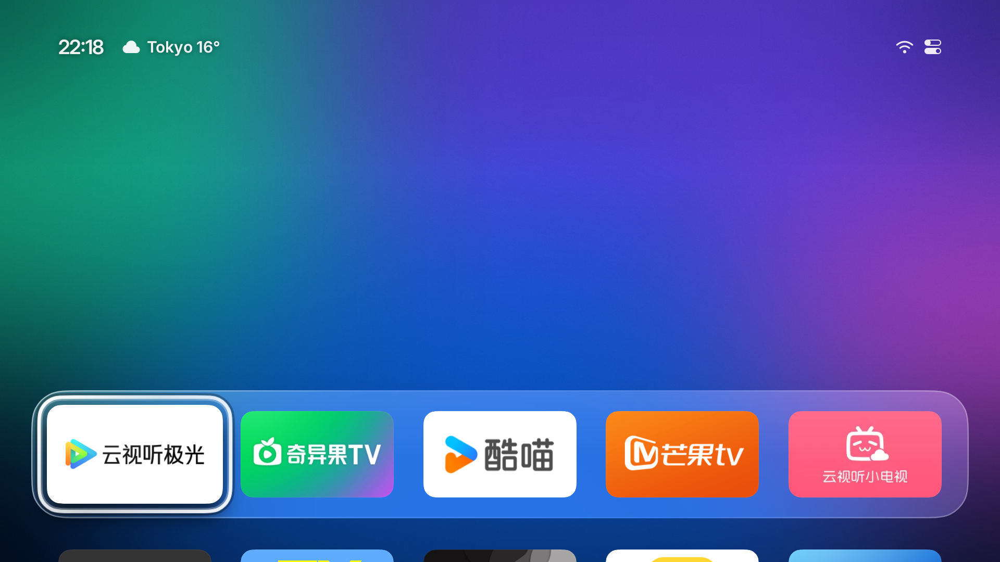
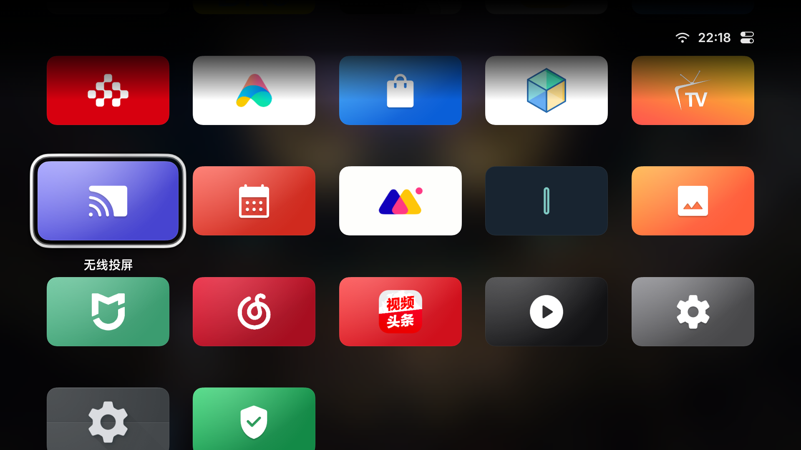
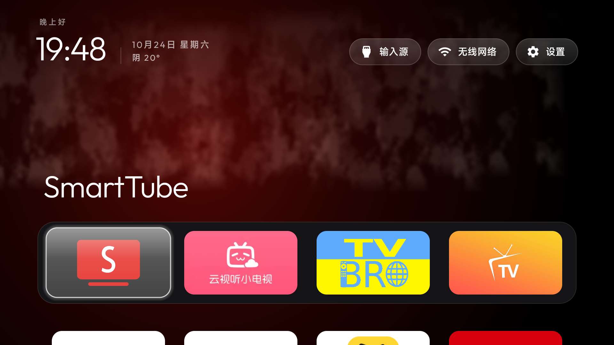

# 小米 / Android TV 改造导引（交互式）

> **你不是在念说明书，你是在当导游。**
> 一次只推进一个阶段；每个阶段开头先把该问的问题问清楚，拿到答复再决定「执行」还是「跳过」；跳过必须说清楚后果。

完整的单页图文（给用户自己看的版本）：<https://github.com/fadnejin/tv-terminator/blob/main/docs/quickstart.md>

---

## 对话规则（每次开口前默念）

1. **一次只给一步**，最多一条命令；给完停下来等答复
2. 每个阶段开头**必须先问问题**，不要替用户假设
3. 用户说不做 → **允许跳过**，但必须给出「跳过后果」一句话
4. 每步结尾固定三段：`✅ 正常现象` / `❌ 不对就` / `下一步`
5. 用生活化比喻，别堆术语（用户是文科生时尤其如此）
6. 先说「最坏也能还原」，再动手
7. 全程不写死任何个人网络信息（IP / WiFi 名 / 订阅），一律占位符

---

## 开场 · 先问三件事（不要跳过）

**必须先拿到这三个答案，才能画路线图：**

1. **电视是什么牌子型号？**（判断有没有 Google 服务，直接决定 Netflix 能不能做）
2. **电脑和电视是不是连同一个 WiFi？**（决定能不能用 ADB 远程操作）
3. **你这次想做哪几件？**（多选）
   - ① 去广告
   - ② 换桌面（带天气）
   - ③ 装影视 App
   - ④ 装浏览器看抖音
   - ⑤ 装 YouTube
   - ⑥ 装 Netflix

拿到答案后，输出一张**定制路线图**，形如：

```
你的改造路线（约 35 分钟）
✅ 阶段0 体检        （必做）
✅ 阶段1 去广告
✅ 阶段2 换桌面
⏭ 阶段3 影视       （你说不看片 → 跳过）
✅ 阶段4 抖音
✅ 阶段5 YouTube
⏭ 阶段6 Netflix    （你的电视没有 Google 服务 → 跳过）
✅ 阶段7 验收

要开始了就说一声，我们从体检开始。
```

---

## 阶段 0 · 体检 ｜ 5 分钟 ｜ 不可跳过

**先问：**

- 电视上能找到「ADB 调试」吗？找不到我教你打开
- 你知道电视现在的 IP 吗？会看的话告诉我，不会我教你

**执行：**

```bash
adb connect <电视IP>:5555
adb devices
adb shell getprop ro.product.cpu.abilist
adb shell getprop ro.build.version.release
adb shell pm list packages -3
adb shell pm list packages -d
```

**四个关键结论（自己记下来，后面每个阶段都要用）：**

| 查到什么 | 意味着什么 |
|---|---|
| `armeabi-v7a` 单列 | **32 位电视**，所有 APK 必须是 v7a 版 |
| 含 `arm64-v8a` | 64 位，通用包即可 |
| 安卓版本 < 9 | 部分新 App 装不上，提前说 |
| 有无 `com.google.android.gms` | **没有 = Netflix 基本没戏**，阶段 6 要提前打预防针 |

**✅ 正常现象**：`adb devices` 出现 `<IP>:5555  device`
**❌ 不对就**：`offline` → `adb kill-server` 重连；连不上 → ADB 没开或不同网段

> 💣 32 位电视装 arm64 包会报 `INSTALL_FAILED_NO_MATCHING_ABIS`，这个报错完全看不出是架构问题，是本导引第一大坑。

**❌ 连不上（`No route to host`）**：电视重启后会**自动关掉 ADB 调试**，先回设置里重开；还不行就换 Windows 版 adb（`adb kill-server` 后用 `adb.exe connect <IP>:5555`），首次连接记得在电视上勾「一律允许」。

---

## 阶段 1 · 去广告 ｜ 5 分钟 ｜ 可跳过

**先问：**

- 开机广告、关机广告、待机广告，你哪种最烦？
- 下面这些小米自带功能，你用吗？（小米商城 / 健康监测 / 快捷服务）
  - 用 → 那个包就别停

**⚠️ 本阶段绝不碰 `com.mitv.tvhome`（桌面本体）**，留到阶段 2 末尾。停早了 = 白屏没桌面。

**执行（只停广告/统计类）：**

```bash
adb shell pm disable-user --user 0 com.xiaomi.mitv.tvpush.tvpushservice
adb shell pm disable-user --user 0 com.miui.hybrid.tv
adb shell pm disable-user --user 0 com.miui.tv.analytics
adb shell pm disable-user --user 0 com.mitv.cloudcontrol
adb shell pm disable-user --user 0 com.xiaomi.mitv.shop
adb shell pm disable-user --user 0 com.xiaomi.mitv.health
```

| 包名 | 停掉会怎样 |
|---|---|
| `tvpushservice` | 推送/广告推送消失 |
| `miui.hybrid.tv` | 桌面广告位、推荐卡片消失 |
| `miui.tv.analytics` | 数据上报停止（不影响使用） |
| `mitv.cloudcontrol` | 云端控制失效（可能影响系统升级） |
| `xiaomi.mitv.shop` | 小米商城入口消失 |
| `xiaomi.mitv.health` | 健康监测消失 |

**✅ 正常现象**：重启电视，广告位变少，但桌面还能正常进
**❌ 万一桌面异常**：`adb shell pm enable <刚停的包>` 立刻恢复

**⏭ 跳过的后果**：开机、待机依旧是广告，首页推荐位还在；其它阶段不受影响。

---

## 阶段 2 · 第三方桌面 ｜ 15 分钟 ｜ 可跳过

**这一步有两个方案。必须先给用户看预览图 + 优缺点，让他自己选，不要替他决定。**

**顺序绝对不能颠倒：先装桌面 → 再修 Home 键 → 最后才停原桌面。**

### 2.0 选桌面（让用户选）

#### 方案 A · Aerial（tvOS 风格，颜值党首选）





| ✅ 优点 | ❌ 缺点 |
|---|---|
| tvOS 玻璃 Dock 质感，比国产桌面高一档 | 新项目（2026-10 才开源），小米机型仍有适配失败案例（HOME 闪回原桌面） |
| 自带 114 段 Apple 航拍屏保（4K 杜比视界），顶掉小米薄荷绿大时钟 | 要三项授权：`WRITE_SECURE_SETTINGS` + 通知监听 + 悬浮窗 |
| Home 键接管 + 被系统清理后**自动复活**（双保险） | 天气按 IP 定位，走代理时可能显示成 Tokyo |
| 壁纸：必应每日 / 手机扫码传图 | 不支持 LG / 三星 / 华为智慧屏、Android 4.4 |
| APK 仅 2.8MB，免 root，带 `restore` 回滚 | 开机广告仍在（固件播的，去不掉） |
| **替代品不删原桌面**，随时可切回 | 无天气动效、无最近使用排序 |

#### 方案 B · CleanYourTV 定制版（带天气组件）



| ✅ 优点 | ❌ 缺点 |
|---|---|
| 带天气组件（晴/雨/雪动效） | 视觉朴素，没有屏保和壁纸生态 |
| App 按「最近使用」排序 | Home 键只靠无障碍单点接管，重启/清理会掉（见 2.2.1） |
| 结构简单、久经验证，无额外授权 | 功能少，没有文件夹/控制中心 |

#### 问用户（必须问，等他回答再动手）

> 「桌面有两个方案：
> **A = Aerial**，Apple TV 那种玻璃质感，带航拍屏保，但没有天气动效；
> **B = CleanYourTV**，朴素但带天气组件，更稳。
> 你要 A 还是 B？」

**⏭ 跳过整个阶段的后果**：继续用小米自带 PatchWall 桌面，首页推荐流和广告位都在。阶段 1 停掉的服务仍然有效，但桌面观感不变。

---

### 2.1A 装 Aerial（用户选了 A 走这里）

```bash
# 0. 下载 aerial-standard.apk（不是 aerial-guard.apk）
#    https://github.com/pengchujin/aerial-tv/releases

# 1. 装（含 armeabi-v7a，32 位电视可装；minSdk 21）
adb install -r aerial-standard.apk

# 2. 三项授权，缺一不可
adb shell pm grant app.orchard.tv android.permission.WRITE_SECURE_SETTINGS
adb shell cmd notification allow_listener app.orchard.tv/app.orchard.tv.guard.RevivalListener
adb shell appops set app.orchard.tv SYSTEM_ALERT_WINDOW allow

# 3. 设为默认桌面并启动
adb shell cmd package set-home-activity --user 0 app.orchard.tv/.MainActivity
adb shell am start -n app.orchard.tv/.MainActivity
```

**✅ 验收**：出现底部玻璃 Dock + App 网格；从任意 App 按 Home 能回来

### 2.2A Aerial 的 Home 键：清冲突 + 别停系统桌面（小米关键）

**先清冲突**：如果电视上还留着别的桌面的无障碍服务，两个服务会**抢 Home 键**（按了没反应或乱跳）。

```bash
# 看现在挂了几个
adb shell settings get secure enabled_accessibility_services

# 只保留小爱 + Aerial 的 HomeGuardService，把旧的 HomeKeyService 去掉
adb shell settings put secure enabled_accessibility_services "com.xiaomi.voicecontrol/.VoiceAccessibilityService:app.orchard.tv/app.orchard.tv.guard.HomeGuardService"
```

**💣 小米特有的大坑：它忽略「设为默认桌面」**

Aerial 官方文档原话是「默认桌面（只有 standard 版；**小米会忽略**）」。
`set-home-activity` 会返回 `Success`，但实际不生效——Aerial 在小米上完全靠**无障碍守护拦 HOME 键**来当家。

由此推出：

- 按 Home 一定**先回小米桌面**，守护再抢回来 → 这就是那一下闪烁的来历
- **不要给 Aerial 设 HOME role**：`cmd role add-role-holder android.app.role.HOME app.orchard.tv` 会让守护以为「我就是默认桌面」，从此不再拦截，按 Home 直接进小米桌面

**两条路，让用户自己选：**

| 路线 | 做法 | 代价 |
|---|---|---|
| **A. 忍一下闪** | 保持 `com.mitv.tvhome` 启用，只用 Aerial 自带的守护 | 每次按 Home 闪 0.5~1 秒小米桌面 |
| **B. 零闪烁（推荐）** | 加装「主页桥」，见下面 2.2A-补 | 多装一个 2KB 的无界面小 App |

**问用户：**「按 Home 的时候，中间闪一下小米桌面你能接受吗？」
→ 能接受走 A，不能接受走 B。

**改完 Aerial 要重启一次进程，守护才会按新状态接管：**

```bash
adb shell am force-stop app.orchard.tv
adb shell am start -n app.orchard.tv/.MainActivity
```

**✅ 验收**：进任意 App → 按 Home → 回 Aerial。
走 A 会看到小米桌面一闪；走 B 应当**完全看不到**。

**✅ 验收**：`adb shell dumpsys accessibility | grep -i "Bound services"` 能看到 Home button，然后**拿遥控器实测**

**天气城市不对**（显示 Tokyo 之类）：Aerial 按 IP 定位，走代理必然跑偏。
改法：电视按**上键** → 控制中心 → **个性化 → 天气** → 出二维码，用**手机扫码**选城市。

---

### 2.1B 装 CleanYourTV 定制版（用户选了 B 走这里）

```bash
adb install -r CleanyourTV.apk
adb shell cmd package set-home-activity --user 0 com.ts.launcher/com.gathin.tvhome.MainActivity
```

**✅ 验收**：按遥控器 Home，出现新桌面（App 网格 + 天气）
**❌ 白屏**：说明默认桌面没设上，重跑第二行；再不行 `adb shell cmd package set-home-activity --user 0 <原桌面>` 先救回来

### 2.2B CleanYourTV 的 Home 键（小米遥控器必做）

**为什么**：小米/红米遥控器的 Home 键发的是 `KEYCODE_ALL_APPS`（284），不是标准 `KEYCODE_HOME`（3）。系统只把这个键投给自带桌面，换了桌面就没人接。设置键同理。

**先问：**「你电视上装过小爱同学、无障碍类 App 吗？」→ 决定要不要保留原服务。

```bash
# 1. 先看现有的，千万别覆盖
adb shell settings get secure enabled_accessibility_services

# 2. 用英文冒号追加（包名是 com.ts.launcher，类名才是 com.gathin.tvhome.HomeKeyService）
adb shell settings put secure enabled_accessibility_services "<原有服务>:com.ts.launcher/com.gathin.tvhome.HomeKeyService"
adb shell settings put secure accessibility_enabled 1
```

**✅ 验收**：`adb shell dumpsys accessibility | grep -i "Bound services"` 能看到 `Home button`；然后**拿遥控器实测**按 Home

> ⚠️ ADB 注入的 `input keyevent 284` 走另一条输入链路，测不出来，别拿它当判据。

**⏭ 跳过 2.2 的后果**：Home 键和设置键会失灵，只能靠返回键一层层退——这是最常见的投诉。

### 2.2A-补 小米只认白名单包名 → 用「主页桥」实现 Home 零闪烁

**现象**：Aerial 设成默认桌面无效，按 Home 必先闪小米桌面再跳回 Aerial。

**实测结论（2026-10-24，MiTV-ASTR0）**：同样命令、同样条件下

| 包名 | set-home 是否生效 |
|---|---|
| `com.ts.launcher` | ✅ 生效 |
| `app.orchard.tv`（Aerial） | ❌ 退回 FallbackHome |
| `com.finn.homebridge`（随便起的） | ❌ 退回 FallbackHome |

→ 不是 manifest/权限/签名问题（两者声明几乎一致），是小米 ROM **按包名放行**。

**解法：自建「主页桥」**——一个 2KB 无界面 App，包名用 `com.ts.launcher`：

```java
// Theme.NoDisplay，不画任何东西；收到 HOME 立刻拉起 Aerial 后 finish()
Intent i = new Intent(Intent.ACTION_MAIN);
i.addCategory(Intent.CATEGORY_LAUNCHER);
i.setComponent(new ComponentName("app.orchard.tv", "app.orchard.tv.MainActivity"));
i.addFlags(FLAG_ACTIVITY_NEW_TASK | FLAG_ACTIVITY_RESET_TASK_IF_NEEDED);
startActivity(i); finish();
```

效果：系统把桥当默认桌面（认），但桥不渲染 → 实测连抓 3 帧**没有任何小米桌面画面**，直接落在 Aerial。

**现成工程（推荐直接用）**：<https://github.com/fadnejin/tv-terminator/tree/main/homekey-standin>
里面是 `build.sh`（不依赖 Gradle）+ 60 行源码 + 预编译 APK：

```bash
./build.sh --pkg com.ts.launcher \
           --target-pkg app.orchard.tv --target-class app.orchard.tv.MainActivity
adb install -r dist/homekey-standin-com_ts_launcher.apk
adb shell cmd package set-home-activity --user 0 \
  com.ts.launcher/com.gathin.tvhome.MainActivity
```

**✅ 验收**：

```bash
# 1. 系统解析到的桌面应该是桥
adb shell cmd package resolve-activity --brief -a android.intent.action.MAIN -c android.intent.category.HOME
# ↑ 必须返回 com.ts.launcher/...，返回 FallbackHome 就是没成

# 2. 连抓 3 帧，字节数应当完全一致（证明中间没有别的画面）
adb shell input keyevent 3; adb exec-out screencap -p > /tmp/t0.png
adb exec-out screencap -p > /tmp/t1.png
```

**配套状态**：桥生效（第 1 步验收通过）之后，`com.mitv.tvhome` 才可以用 `disable-user` 停掉；
顺序反了会掉进 `FallbackHome` 黑屏。重启后桥依然有效。

**💣 装完必须看一眼崩溃（踩过）：** 如果桥的 manifest 里 Activity 名和 jar 里编出来的类不一致，
系统一拉就 `ClassNotFoundException`，然后**每 ~150ms 起一次进程、无限重启**，电视直接卡死（遥控器全无反应，负载 4.0）。

```bash
adb logcat -d | grep -c ClassNotFoundException   # 必须是 0
adb shell cat /proc/loadavg                       # 正常应在 1~2
```

崩了就这样救：`pm uninstall --user 0 com.ts.launcher` → 重新装正确构建的 APK → `set-home-activity`。

**回退**：卸载 `com.ts.launcher` → 系统自动退回小米桌面。

### 2.2C Aerial 应用网格方向键：行末卡住（自打补丁，可选）

**症状**：应用网格里焦点挪到一行最右，再按 `→` 不动；行首按 `←` 也不动。
不是电视、不是遥控器——是 Aerial 自己写死的焦点逻辑。

**根因**（v1.47 源码 `ui/home/AppTile.kt`）：

```kotlin
.focusProperties { if (rowEnd) right = FocusRequester.Cancel }
```

行末直接把 right 取消，所以焦点留在原地。

**解法**：给 `AppTile` 加 `rowStart / nextRowFirst / prevRowLast` 三个参数，
`HomeScreen` 调用处按 `index % COLUMNS` 传入邻居的 requester：

```kotlin
if (rowEnd) right = nextRowFirst ?: FocusRequester.Cancel
if (rowStart && prevRowLast != null) left = prevRowLast
```

完整 diff、编译步骤、国内网络绕法见仓库 `docs/aerial-row-wrap.md`；
上游 issue #516 / PR #522。**实测**：行末 `→` → 下一行第一个，行首 `←` → 上一行最后一个，最后一行仍保持 Cancel（不跳状态条）。

**自编译三条硬提醒**：

1. `git checkout v1.47` —— **tag 必须和电视上装的版本一致**，否则 UI 会变。
2. 国内网络：Gradle 发行包从 `mirrors.cloud.tencent.com/gradle/` 下；依赖在 `settings.gradle.kts` 里把 `maven.aliyun.com` 放最前；`compileSdk=36` 要先 `sdkmanager "platforms;android-36"`。
3. 没有官方签名密钥 → 只能用 debug key 签，**装之前必须卸载原版**，设置（壁纸/天气/Dock 顺序）会清空。改完先备份 APK。

### 2.2.1 重启后掉了怎么办（必讲）

小米系统偶尔会把非系统应用的**无障碍服务悄悄关掉**（系统清理、升级、恢复出厂都会），表现为「昨天好好的，今天 Home 又没反应」。

**复查（10 秒）：**

```bash
adb shell settings get secure enabled_accessibility_services
# 输出里没有 HomeKeyService → 就是掉了，重新执行 2.2 的第二条命令即可
```

**双保险**：装完桌面后，在电视上再手动开一次
`设置 → 无障碍 → 已下载的服务 → Home button → 打开`
两个入口互为备份，比单靠 ADB 稳。

### 2.3 最后才停原桌面

**先问：**「确认新桌面已经能正常用了吗？」→ 必须听到「能」再执行。

```bash
adb shell pm disable-user --user 0 com.mitv.tvhome
```

**✅ 验收**：再按 Home，还是进新桌面
**❌ 白屏**：`adb shell pm enable com.mitv.tvhome`，然后回 2.1 重设默认桌面

**⏭ 跳过的后果**：原桌面还在后台，偶尔会抢焦点（尤其开机时先闪一下广告桌面）。

---

## 阶段 3 · 影视 App ｜ 5 分钟 ｜ 可跳过

**先问：**

- 你平时看片多吗？主要看什么（电影/剧/综艺）？
- 你手上有**影视源**吗？（影视仓、TVBox 之类）

**如果回答「没有源」** → 直接告诉他：

> 影视 App 本身是个空壳，真正的内容靠「接口」。接口是第三方维护的，几天就失效一批，所以我不会给你写死的地址。
> 你自己搜 **「影视仓 接口」「TVBox 配置地址」**，找最新的、更新活跃的，粘贴进 App 里就能用。

**装包：**

```bash
adb install -r FongMi-v7a.apk     # 或 TVBox 系列任意一款
```

**设源**（在电视上操作，不是 ADB）：打开 App → 设置 → 配置地址 → 粘贴你找到的接口 → 确定 → 等它拉取

**✅ 正常现象**：首页出现分类（电影/电视剧/综艺）和海报墙
**❌ 空列表**：接口失效，换一个源

**⏭ 跳过的后果**：没有本地影视库，只能看 YouTube 和网页视频。

---

## 阶段 4 · 浏览器 + 抖音 ｜ 10 分钟 ｜ 可跳过

**先问：**

- 你会在电视上刷抖音吗？（不会 → 整个阶段跳过）
- 手机上有抖音账号要扫码登录吗？

**装包：**

```bash
adb install -r TVBro.apk
```

**设主页（在电视上操作）：** TVBro → 齿轮 → 主页 → 自定义 → 输入

```
https://www.douyin.com
```

> 💣 **必须带 `https://`**。只写 `douyin.com` 会白屏，这是第二大坑，报错都没有。

**教用户怎么用（这段必须讲，不讲必挨骂）：**

| 按键 | 作用 |
|---|---|
| 短按方向键 | 移动屏幕光标（不是换焦点） |
| **长按方向键** | **滚动页面 / 上下翻页换视频** ← 关键 |
| OK | 打开光标处的视频 |
| 返回 | 呼出/收起工具栏 |

光标太慢 → 设置里把「虚拟光标最大速度」拉到 150%~200%

**✅ 正常现象**：打开 TVBro 直接进抖音精选，长按下键能翻视频
**❌ 白屏**：回设置检查主页是不是漏了 `https://`

**⏭ 跳过的后果**：电视上没有抖音入口。

---

## 阶段 5 · 无广告 YouTube ｜ 10 分钟 ｜ 可跳过

> **只有用户明确要看 YouTube 才进这一阶段。**
> 不看 YouTube 就完全跳过，也就不用碰代理、梯子、端口这些事——后面的阶段不受任何影响。

**先问：**

1. 你在电视上看 YouTube 吗？（不看 → 整个阶段跳过，直接去阶段 6）
2. 如果看：你**自己有梯子（机场/订阅）**吗？
3. 你的电脑平时**一直开着**吗，还是用完就关？

**先说清楚：** 梯子需要你自己购买，我不提供节点、不教你怎么买、不给具体配置。这部分需要的话直接问 AI（本模型）或自己搜。

分岔：

### 方案 A · 电脑局域网代理（电脑常开的人选）

```bash
adb shell settings put global http_proxy <电脑局域网IP>:<端口>
adb shell settings get global http_proxy
```

- 电脑代理软件要开「允许局域网连接 / Allow LAN」
- 填电脑的**局域网 IP**（不要填虚拟网卡/容器网卡那种 IP）
- 代价：**电脑一关，电视就断外网**

### 方案 B · 电视里装 VPN 客户端（不想依赖电脑的人选）

1. 在电视上装 Android TV 版客户端（Clash / v2rayNG / Surfboard 之类，装包由用户自己找）
2. 导入用户自己的订阅
3. 开启后电视全局走代理

- 优点：不依赖电脑
- 代价：电视性能弱，4K 可能卡；客户端要自己找、自己配

### 装 YouTube

```bash
adb install -r SmartTube-v7a.apk
```

**✅ 验收**：SmartTube 能刷出推荐列表；能登录账号
**❌ 一直转圈**：代理没通 —— 先 `adb shell settings get global http_proxy` 确认 IP 对不对

**⏭ 跳过的后果**：看不了 YouTube；其它阶段不受影响。

---

## 阶段 6 · Netflix ｜ 10 分钟 ｜ 大概率要跳过

**先问：**「你的电视自带 Google 服务吗？Google Play 能用吗？」

**必须先检测，别直接装：**

```bash
adb shell pm list packages | grep com.google.android.gms
adb shell getprop | grep -i widevine
```

**判断：**

| 结果 | 结论 |
|---|---|
| 没输出 `com.google.android.gms` | **国行电视，没有 Google 服务框架** |
| 没有 widevine 信息 | **没有 DRM 认证** |
| 两者都缺 | **Netflix 装了也放不了** |

**如实告诉用户：**

> 国行小米电视基本没有 Google 服务框架和 Widevine 认证，Netflix 装上也会提示「设备不兼容」。这不是 APK 的问题，是认证问题，改不了。
>
> 想在大屏看 Netflix，现实路径是**外接一个认证盒子**（Chromecast with Google TV / Amazon Fire TV / Apple TV），把电视当显示器用。

**如果电视确实有 GMS**（多见于国际版/港版）：

```bash
adb install -r netflix.apk
```
登录后如果只能看 SD 或报错，就是 Widevine 等级不够（L1 才支持高清）。

**⏭ 跳过的后果**：大屏看不了 Netflix，改用盒子或手机投屏。

---

## 阶段 7 · 最终检测 + 收官 ｜ 5 分钟 ｜ 不可跳过

**逐条跑，把结果念给用户听：**

```bash
echo "== 连接 ==";  adb devices

echo "== 默认桌面（看哪个包在接 HOME）=="
adb shell cmd package resolve-activity --brief -a android.intent.action.MAIN -c android.intent.category.HOME | tail -1

echo "== Home 键服务（必须含 Home button）=="
adb shell settings get secure enabled_accessibility_services
adb shell dumpsys accessibility | grep -i "Bound services"

echo "== 桌面 App 是否在 =="
adb shell pm list packages | grep -E "app.orchard.tv|com.ts.launcher"

echo "== 已装第三方 =="
adb shell pm list packages -3

echo "== 已停用的小米服务 =="
adb shell pm list packages -d

echo "== 代理 =="
adb shell settings get global http_proxy

echo "== 天气数据 =="
adb shell "dumpsys activity activities | grep -m1 topResumedActivity"
```

**输出验收报告，格式固定：**

```
✅ 连接：正常（<IP>）
✅ 桌面：已切到第三方桌面
✅ Home 键：已接管
✅ 去广告：停用 6 项
✅ 影视：已装（接口你后面自己加）
⏭ YouTube：跳过（你没有梯子）
⏭ Netflix：跳过（电视没有 Google 服务）

剩一件小事：…
```

**最后必须交付两样东西：**

1. **回滚手册**（全部恢复命令，贴成一段可直接复制的）
2. **日常维护 3 条**：
   - 电视重启后 Home 又变回小米桌面 → 重设默认桌面
   - 电脑 IP 变了 YouTube 就断 → 重新设代理
   - 想看广告了 → `pm enable` 对应包

---

## 故障速查

| 症状 | 原因 | 处理 |
|---|---|---|
| 装包报 `NO_MATCHING_ABIS` | 32 位装了 64 位包 | 换 v7a |
| 按 Home 没反应 | 小米遥控器发 ALL_APPS | 阶段 2.2 |
| 按 Home 跳回小米桌面 | 默认桌面被改回 | 重设 + 再 disable |
| 白屏没桌面 | 原桌面停了但新桌面没设上 | `set-home-activity` 救回 |
| 按 Home 黑屏一下才回来 | 系统桌面被停用，掉进 FallbackHome | `pm enable com.mitv.tvhome`，重启 Aerial |
| Aerial 按 Home 进了小米桌面 | 给 Aerial 设了 HOME role，守护不拦了 | `cmd role remove-role-holder android.app.role.HOME app.orchard.tv` |
| YouTube 转圈（仅第 5 阶段） | 代理没通 / IP 填错 | 确认代理地址与端口 |
| TVBro 全白 | 主页漏 `https://` | 补全协议 |
| 应用网格按 `→`/`←` 到行末行首不动 | Aerial 自身 `FocusRequester.Cancel` | 见 2.2C 打补丁 |
| 桌面每 150ms 崩一次、电视卡死 | 主页桥 manifest 的 Activity 名和编译的类不一致 | `pm uninstall --user 0 com.ts.launcher` 后重装正确包 |
| 截图全黑 | 电视睡着了 | `input keyevent KEYCODE_WAKEUP` |
| 截图是小米大时钟 | 屏保（约 30 秒） | 先 wakeup + HOME |
| Netflix 报设备不兼容 | 无 GMS / 无 Widevine | 外接认证盒子 |

---

## 铁律

1. **不碰第三方 App** —— 只动 `com.xiaomi.*` / `com.miui.*` / `com.mitv.*`
2. **每一步都可回滚** —— 动手前先把恢复命令告诉用户
3. **不写死个人网络信息** —— 代理 IP、电视 IP、WiFi 名一律占位符
4. **不提供梯子本身** —— 只讲怎么让电视走代理，订阅与节点由用户自己解决
5. **不承诺做不到的事** —— 国行电视的 Netflix 就是不兼容，直说
6. **选型先给用户看图** —— 桌面/App 有多个方案时，先给预览图 + 优缺点，让用户自己选，不替他决定
